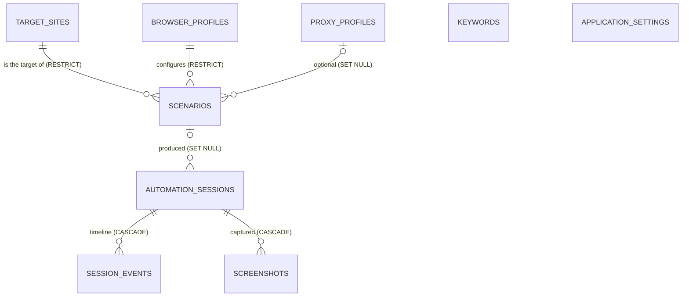

# Database design

SQLite, accessed through SQLAlchemy 2 (typed `Mapped[...]` models) and versioned with Alembic. The file
lives at `data/sjat.db` by default (configurable). Connections enable `PRAGMA foreign_keys=ON` and WAL
journaling.

## Entity-relationship overview



`keywords` is a reusable library, not a foreign key: a scenario stores the keyword text so that renaming
or deleting a library entry cannot change a scenario or its history.

## Tables

| Table | Purpose | Notes |
| --- | --- | --- |
| `target_sites` | The automation allowlist | `approved_for_automation` and `enabled` must both be true; `domain` indexed |
| `browser_profiles` | Viewport, locale, time zone, headless, JavaScript, downloads, user-agent mode | Empty locale/time zone = browser default |
| `proxy_profiles` | Protocol, host, port, username, last test result | **No password column**; `has_password` only records that a secret exists in the OS credential store |
| `scenarios` | Keyword, target, profiles, dwell range, iterations, scroll and session options | Check constraints keep the data valid even if the application is bypassed |
| `automation_sessions` | One row per iteration | Copies scenario name, keyword and target, plus `settings_snapshot` (JSON) |
| `session_events` | Timeline | One row per event with its state and a JSON `data` payload |
| `screenshots` | Metadata of captured images | The file itself lives in `data/screenshots/YYYY-MM-DD/` |
| `keywords` | Reusable keyword library | Unique text (case-insensitive in the repository), JSON `tags` |
| `application_settings` | Key/value user settings | Values are JSON, so booleans and numbers round-trip exactly |

## Integrity rules enforced by the database

`scenarios`: `min_dwell_seconds >= 0`, `max_dwell_seconds >= min_dwell_seconds`, `iterations > 0`,
`delay_between_iterations >= 0`, `max_scroll_actions >= 0`, `simulated_position` is NULL or 1-10.

Foreign keys: a target site or browser profile that is still used cannot be deleted (`RESTRICT`); deleting
a proxy profile clears the reference (`SET NULL`, but the application refuses to delete a profile that
scenarios use, so none silently switches to a direct connection); deleting a session removes its events
and screenshot rows (`CASCADE`).

## Auditability

A session must keep its meaning after the scenario changes or disappears. Therefore a session copies the
descriptive fields and stores `settings_snapshot`: the complete plan (secrets removed), the random seed,
the chosen dwell time and the full interaction schedule. Deleting a scenario sets `scenario_id` to NULL
and leaves the history untouched.

## Indexes

Foreign keys used in joins and filters (`scenarios.target_site_id`, `.browser_profile_id`,
`.proxy_profile_id`, `.enabled`, `.keyword`), `target_sites.domain` and `.approved_for_automation`,
`keywords.enabled`, and for the history and reports `automation_sessions.started_at`, `.keyword`,
`.target_domain`, `.run_id`, `.scenario_id`, the composite `(status, started_at)`, and the composite
`session_events (session_id, timestamp)`.

## Conventions

- Enums are stored by **value** in a `VARCHAR` (no native enum type), validated on write.
- Timestamps are naive UTC (`utcnow()`); the GUI converts to local time for display only.
- Constraint names follow a naming convention so SQLite "batch" migrations are deterministic.
- Relationships needed after a session closes are eager-loaded (`lazy="joined"` on scenario references).

## Migrations

`migrations/versions/0001_initial_schema.py` creates the schema. `DatabaseMigrator` runs Alembic
programmatically at start-up (no dependency on the working directory). A database that contains tables
but no migration history is refused instead of being guessed at. A test compares the migrated schema
with the ORM models, so the two cannot drift apart.

```powershell
alembic revision --autogenerate -m "describe the change"   # development
```

## Backup and restore

`BackupService` uses SQLite's online-backup API (consistent even while the application runs).
A restore first validates the file (SQLite header, integrity check, required tables, known schema
revision), refuses while an automation run is active, saves a `pre-restore` safety copy, replaces the
database, upgrades its schema if the backup is older, and rolls back to the safety copy if anything
fails.
